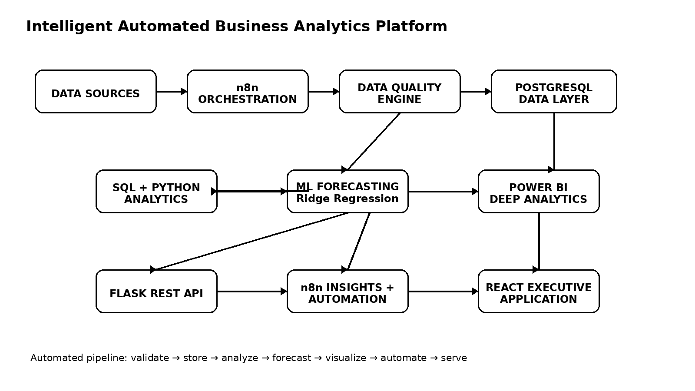
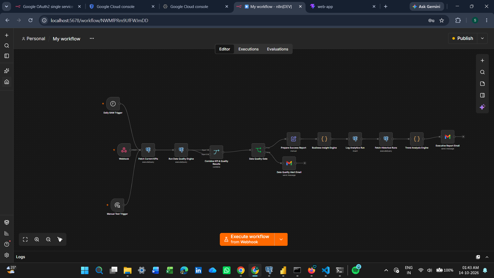
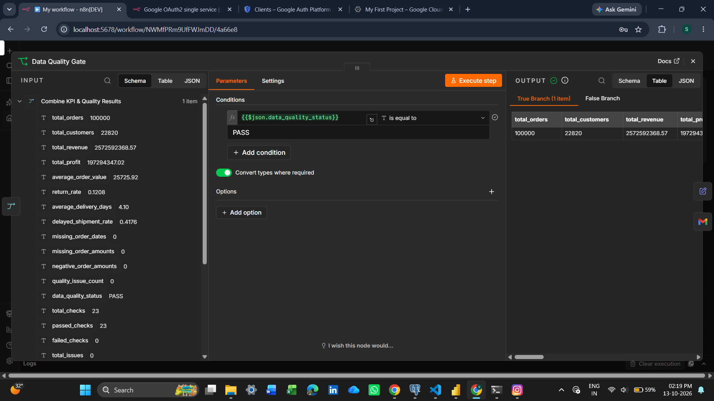
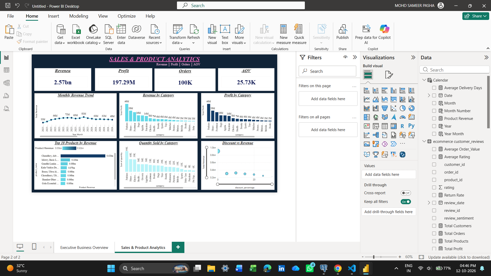
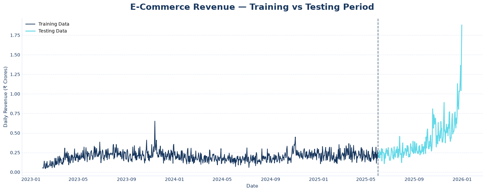
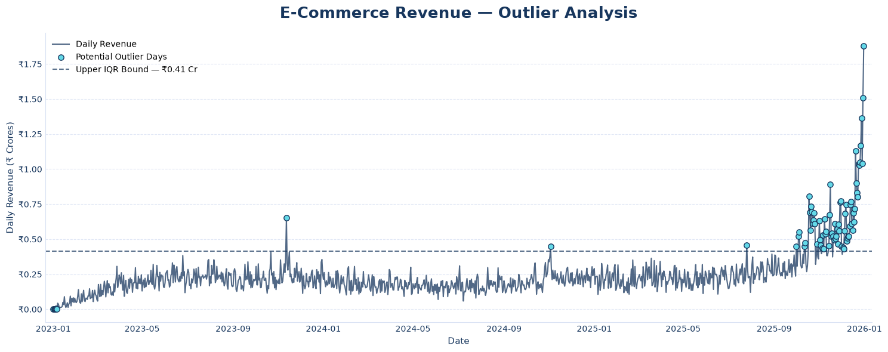

# Intelligent Automated Business Analytics Platform

<p align="center">
  <strong>Python • SQL • PostgreSQL • Machine Learning • Power BI • n8n • Flask • React</strong>
</p>

<p align="center">
  An end-to-end business analytics platform that transforms relational e-commerce data into automated, forecast-driven, executive decision support.
</p>

<p align="center">
  
  
  
  
  
  
  
</p>

---

## 1. Executive Summary

**Intelligent Automated Business Analytics Platform** is a full-stack analytics system built to simulate a production-style e-commerce intelligence environment.

The project connects **data validation, PostgreSQL, SQL analytics, Python analytics, machine learning forecasting, Power BI, workflow automation, a Flask API, and a React executive interface** into one end-to-end pipeline.

Instead of treating analytics as a collection of disconnected notebooks and dashboards, the platform is designed around a complete decision-support flow:

```text
Business Data
     ↓
Validation & Quality Checks
     ↓
PostgreSQL Data Layer
     ↓
SQL + Python Analytics
     ↓
Machine Learning Forecasting
     ↓
Power BI Intelligence Layer
     ↓
n8n Automation & Business Insight Engine
     ↓
Flask REST API
     ↓
React Executive Web Application
```

### What this project demonstrates

- Relational data modeling
- Data quality engineering
- SQL business analytics
- Python-based analytics
- Machine learning forecasting
- Business intelligence with Power BI
- Workflow orchestration with n8n
- REST API development
- React-based executive visualization
- Automated reporting
- Historical analytics tracking
- Security-aware configuration
- Git/GitHub project management

---

## 2. Why This Project Exists

### The problem

Modern businesses collect data from many operational areas:

- Orders
- Customers
- Products
- Payments
- Shipments
- Returns
- Reviews
- Marketing campaigns

The difficult part is not simply storing this data. The real challenge is turning it into **reliable, timely, actionable business intelligence**.

A traditional workflow may look like:

```text
Raw Files → Manual Cleaning → Manual Analysis → Static Dashboard
```

This creates several problems:

- Data quality issues can remain hidden.
- KPI calculations may be manual.
- Operational problems are discovered late.
- Forecasting is disconnected from reporting.
- Business users must switch between tools.
- Repeated analysis requires repeated manual work.

### The solution

This platform creates an automated analytics pipeline:

```text
Raw Business Data
       ↓
Automated Validation
       ↓
Structured PostgreSQL Database
       ↓
SQL & Python Analytics
       ↓
ML Forecasting
       ↓
Business Intelligence
       ↓
Automated Insights
       ↓
Executive Web Application
```

The result is a reusable analytics environment that can evolve from a local project into a production-style cloud platform.

---

## 3. Core Capabilities

| Capability | Implementation |
|---|---|
| Data ingestion | CSV / structured business datasets |
| Data validation | Python + SQL + n8n |
| Data storage | PostgreSQL |
| Business analytics | SQL + Python |
| Statistical analysis | Python |
| Machine learning | Scikit-learn / Ridge Regression |
| Forecasting | Next-day revenue prediction |
| BI reporting | Power BI + DAX |
| Workflow automation | n8n |
| Business insight generation | n8n workflow |
| Historical run tracking | PostgreSQL |
| Backend | Flask |
| Frontend | React + Vite |
| API integration | REST + authenticated n8n webhook |
| Notifications | Email automation |
| Version control | Git + GitHub |

---

# 4. System Architecture



```text
                         ┌──────────────────────────┐
                         │       DATA SOURCES       │
                         │ CSV / Excel / APIs / DB  │
                         └────────────┬─────────────┘
                                      │
                                      ▼
                         ┌──────────────────────────┐
                         │          n8n             │
                         │ Workflow Orchestration   │
                         └────────────┬─────────────┘
                                      │
                                      ▼
                         ┌──────────────────────────┐
                         │   DATA QUALITY ENGINE    │
                         │ Validation + KPI checks  │
                         └────────────┬─────────────┘
                                      │
                                      ▼
                         ┌──────────────────────────┐
                         │       PostgreSQL         │
                         │ Relational Data Layer    │
                         └───────┬─────────┬────────┘
                                 │         │
                    ┌────────────┘         └─────────────┐
                    ▼                                    ▼
          ┌──────────────────┐                  ┌──────────────────┐
          │   SQL ANALYTICS  │                  │ PYTHON ANALYTICS │
          │ Business Metrics │                  │ EDA / Statistics │
          └────────┬─────────┘                  └────────┬─────────┘
                   │                                     │
                   └────────────────┬────────────────────┘
                                    ▼
                         ┌──────────────────────────┐
                         │   ML FORECASTING LAYER  │
                         │ Ridge Regression Model  │
                         └────────────┬─────────────┘
                                      │
                    ┌─────────────────┴─────────────────┐
                    ▼                                   ▼
          ┌──────────────────┐                ┌──────────────────┐
          │    Power BI      │                │   n8n Insights   │
          │ Deep Analytics   │                │ Automation / AI  │
          └────────┬─────────┘                └────────┬─────────┘
                   │                                   │
                   └────────────────┬──────────────────┘
                                    ▼
                         ┌──────────────────────────┐
                         │       Flask API         │
                         │ REST + Integration Layer│
                         └────────────┬─────────────┘
                                      │
                                      ▼
                         ┌──────────────────────────┐
                         │     React Web App        │
                         │ Executive Analytics UI   │
                         └──────────────────────────┘
```

---

# 5. End-to-End Data Flow

### Step 1 — Business data

The primary environment uses a **synthetic Indian e-commerce dataset** containing relational business entities.

### Step 2 — Data quality

The pipeline validates data and calculates quality status before business reporting proceeds.

### Step 3 — PostgreSQL

Validated business entities are stored in a relational PostgreSQL schema.

### Step 4 — SQL analytics

SQL is used for:

- Revenue analysis
- Profitability
- Customer analysis
- Product performance
- Return analysis
- Shipment performance
- Warehouse analysis
- Data quality checks
- Advanced business analytics

### Step 5 — Python analytics

Python handles:

- Data profiling
- Cleaning
- Exploratory analysis
- Statistical processing
- Forecasting preparation

### Step 6 — Machine learning

The forecasting pipeline produces a next-day revenue prediction.

### Step 7 — Power BI

Power BI provides the deep analytical and executive dashboard layer.

### Step 8 — n8n

n8n orchestrates the recurring analytics workflow and business reporting.

### Step 9 — Flask

Flask exposes analytics results through REST endpoints and securely proxies the automation request to n8n.

### Step 10 — React

The React application presents the latest business state in an executive-friendly interface and can trigger a new analytics run.

---

# 6. Dataset

The primary dataset is a **synthetic Indian e-commerce dataset** created to simulate a realistic relational business environment.

> The dataset is explicitly treated as synthetic. It is not presented as real Amazon, Flipkart, or other marketplace production data.

### Included entities

```text
customers
products
orders
order_items
payments
shipments
returns
customer_reviews
marketing_campaigns
```

### Approximate source scale

| Entity | Rows |
|---|---:|
| Customers | 25,000 |
| Products | 550 |
| Orders | 100,000 |
| Order Items | 254,331 |
| Payments | 100,000 |
| Shipments | 89,681 |
| Returns | 12,075 |
| Customer Reviews | 77,530 |
| Marketing Campaigns | 151 |

### Relational structure

```text
customers
    │
    └── customer_id
            │
            ▼
         orders
            │
       ┌────┼─────┬──────────┬─────────┐
       ▼    ▼     ▼          ▼         ▼
 order_items payments shipments returns reviews
       │
       ▼
    products

orders
  │
  └── campaign_id
          │
          ▼
 marketing_campaigns
```

---

# 7. PostgreSQL Data Layer

The database is:

```text
Database: intelligent_business_analytics
Schema: ecommerce
```

The PostgreSQL layer provides the central analytical data foundation.

### Major SQL modules

```text
sql/
├── schema.sql
├── data_quality.sql
├── business_analysis.sql
├── analytics_run_history.sql
├── advanced_business_analytics.sql
└── sales_forecasts.sql
```

### Historical analytics tracking

Every successful analytics execution can be recorded in:

```text
ecommerce.analytics_run_history
```

This enables the platform to move beyond a single static analysis and track business state over repeated executions.

---

# 8. Business Analytics

The platform analyzes the business across multiple dimensions.

### Revenue & Sales

- Total revenue
- Monthly revenue
- Average order value
- Category revenue
- Product revenue
- Top products

### Profitability

- Total profit
- Category-level profit contribution
- Product-level profitability
- Margin analysis
- Loss-making product identification

### Customers

- Customer counts
- Customer segments
- Customer value
- Customer order behavior

### Operations

- Delivery performance
- Shipping methods
- Shipment delays
- Warehouse performance
- Operational risk

### Returns

- Return volume
- Return rate
- Return reasons
- Return rate by category

### Marketing

- Campaign relationships
- Campaign-linked order analysis

---

# 9. Key Business Results

The current analytics environment produces:

| KPI | Current Result |
|---|---:|
| Total Revenue | ₹2.57 Billion |
| Total Profit | ₹197.29 Million |
| Total Orders | 100,000 |
| Total Customers | 22,820 |
| Average Order Value | ₹25,725.92 |
| Return Rate | 12.08% |
| Average Delivery Time | 4.10 days |
| Delayed Shipment Rate | 41.76% |
| Data Quality | PASS |

### Important business finding

The platform identifies a **41.76% delayed shipment rate**.

This exceeds the configured operational threshold and therefore produces:

```text
ATTENTION REQUIRED
```

This demonstrates an important distinction between:

> **“The business has strong revenue.”**

and:

> **“The business is operationally healthy.”**

The platform is designed to surface both.

---

# 10. Machine Learning Forecasting

The project includes a production-oriented revenue forecasting component.

### Model

```text
Ridge Regression
```

### Current production evaluation

| Metric | Result |
|---|---:|
| Model MAPE | 16.91% |
| Forecast horizon | Next day |
| Forecasted revenue | ₹12.09 Million |

### Why next-day forecasting?

The project deliberately avoids presenting an unreliable recursive long-horizon forecast as if it were production-ready.

The implemented production pipeline focuses on a **single next-day prediction**, which is easier to validate and integrate into operational decision-making.

### Forecast pipeline

```text
Historical Revenue
       ↓
Feature Preparation
       ↓
Train / Validation
       ↓
Ridge Regression
       ↓
Model Evaluation
       ↓
Next-Day Prediction
       ↓
PostgreSQL
       ↓
Power BI + Flask + React
```

---

# 11. Power BI Intelligence Layer

Power BI is used as the deep analytical layer of the platform.

### Dashboard coverage

#### Sales & Revenue

- Monthly revenue trend
- Revenue by product category
- Top 5 products
- Profit contribution by category
- Regional revenue visualization

#### Operations

- Average delivery days
- Return rate
- Delayed shipment rate
- Delivery status distribution
- Shipping method performance
- Shipping delay hotspots
- Returns by reason
- Return rate by product category
- Warehouse performance

#### Forecasting

- Actual vs predicted revenue
- Next-day predicted revenue
- Forecast date
- Model MAPE

#### Risk monitoring

The dashboard includes an operational risk alert driven by the delayed shipment rate.

---

# 12. n8n Automation Layer

n8n is used as the **workflow orchestration layer**, not as the primary analytics engine.

### Production workflow

```text
Manual Test Trigger ──────┐
                          │
Daily 8AM Trigger ────────┼──► Fetch Current KPIs
                          │
Webhook ──────────────────┘
                                      ↓
                           Run Data Quality Engine
                                      ↓
                         Combine KPI & Quality Results
                                      ↓
                             Data Quality Gate
                              /             \
                           PASS              FAIL
                            ↓                  ↓
                 Prepare Success Report   Quality Alert
                            ↓
                  Business Insight Engine
                            ↓
                    Log Analytics Run
                            ↓
                   Fetch Historical Runs
                            ↓
                    Trend Analysis Engine
                            ↓
                   Respond to Webhook
                            ↓
                 Executive Report Email
```

### Automation capabilities

- Daily scheduled execution
- Manual execution
- Authenticated webhook execution
- Data-quality gating
- KPI retrieval
- Business insight generation
- Historical run logging
- Trend analysis
- Executive email reporting
- Failure-path alerts

---

# 13. Flask REST API

The Flask backend provides the application integration layer.

### API endpoints

```text
GET  /api/health
GET  /api/dashboard
GET  /api/kpis
GET  /api/operations
GET  /api/forecast
GET  /api/data-quality
GET  /api/automation/status
GET  /api/analytics/history
GET  /api/insights
POST /api/automation/run
```

### Architecture principle

The n8n authentication secret is kept on the backend.

```text
React
  │
  │  request
  ▼
Flask
  │
  │ authenticated server-side request
  ▼
n8n Webhook
```

The secret is **not exposed to the React client**.

---

# 14. React Executive Application

The project includes a React + Vite executive interface.

The application provides a centralized view of:

- Business KPIs
- Revenue
- Profit
- Customers
- Returns
- Delivery performance
- Data quality
- Forecasting
- Business health
- Automation status

### Run Analysis

The application includes a **Run Analysis** action that triggers:

```text
React
  ↓
Flask
  ↓
n8n Production Webhook
  ↓
Analytics Workflow
  ↓
PostgreSQL
  ↓
Flask
  ↓
React
```

This completes the end-to-end application loop.

---

# 15. Project Evidence

## n8n Automation Workflow



## n8n Data Quality Layer



## Power BI Executive Dashboard



## Forecasting Validation






---

# 16. Project Structure

```text
Intelligent-Business-Analytics/
│
├── data/
│   ├── raw/
│   │   ├── indian_ecommerce/
│   │   └── ecommerce_sales_analytics/
│   └── processed/
│
├── notebooks/
│   ├── 01_dataset_profiling.ipynb
│   ├── 02_data_cleaning.ipynb
│   ├── 03_eda.ipynb
│   └── 04_ml_forecasting.ipynb
│
├── python/
│   ├── data_validation.py
│   ├── data_cleaning.py
│   ├── analytics.py
│   └── forecasting.py
│
├── sql/
│   ├── schema.sql
│   ├── data_quality.sql
│   ├── business_analysis.sql
│   ├── analytics_run_history.sql
│   ├── advanced_business_analytics.sql
│   └── sales_forecasts.sql
│
├── n8n/
│   └── workflows/
│
├── dashboard/
│   └── powerbi/
│       └── PowerBI_Final.pbix
│
├── api/
│   └── app.py
│
├── web-app/
│   ├── src/
│   ├── package.json
│   └── vite.config.js
│
├── documentation/
│   ├── architecture/
│   ├── data_dictionary/
│   └── reports/
│
├── tests/
│
├── requirements.txt
├── .gitignore
└── README.md
```

---

# 17. Testing

The project includes automated tests for the forecasting component.

Current result:

```text
2 forecasting tests passed
```

Testing is intended to expand as the platform moves toward production deployment.

---

# 18. Security & Configuration

Sensitive configuration is managed through environment variables.

Examples:

```text
DB_HOST
DB_PORT
DB_NAME
DB_USER
DB_PASSWORD
N8N_WEBHOOK_URL
N8N_API_KEY
```

The project `.gitignore` excludes:

```text
.env
.env.*
venv/
.venv/
__pycache__/
node_modules/
dist/
.pytest_cache/
.ipynb_checkpoints/
```

### Security principle

Credentials must never be committed to the public repository.

For public deployment:

- Rotate development secrets.
- Use platform-managed environment variables.
- Use HTTPS.
- Restrict webhook access.
- Keep database credentials server-side.
- Never place n8n authentication secrets in React.

---

# 19. Local Development

## Prerequisites

- Python
- PostgreSQL
- Node.js
- n8n
- Power BI Desktop
- Git

## Backend

```bash
python -m venv venv
```

Windows:

```bash
venv\Scripts\activate
```

Install dependencies:

```bash
pip install -r requirements.txt
```

Configure the local `.env` file with the required database and n8n values.

Start Flask:

```bash
python api/app.py
```

## Frontend

```bash
cd web-app
npm install
npm run dev
```

## n8n

Start n8n and activate the **Automated Daily Analytics** workflow.

The production application should communicate with n8n through the Flask backend rather than exposing credentials to the browser.

---

# 20. What This Platform Can Become

The current project is a foundation for a much larger analytics product.

It can evolve into a:

### Business Intelligence Platform

Executives can monitor:

- Revenue
- Profit
- Customers
- Operations
- Returns
- Forecasts
- Risks

### Automated Decision-Support System

The platform can automatically:

- Detect business anomalies
- Identify operational risks
- Generate recommendations
- Notify stakeholders
- Track historical changes

### AI-Powered Analytics Platform

Future AI capabilities can provide:

```text
"What happened?"
       ↓
"Why did it happen?"
       ↓
"What is likely to happen next?"
       ↓
"What should the business do?"
```

---

# 21. Future Roadmap

## Phase 1 — Foundation

- [x] Relational e-commerce dataset
- [x] PostgreSQL data layer
- [x] Data-quality engine
- [x] SQL business analytics
- [x] Python analytics
- [x] Power BI dashboard
- [x] ML revenue forecasting

## Phase 2 — Automation

- [x] n8n orchestration
- [x] Scheduled analytics
- [x] Webhook execution
- [x] Historical run tracking
- [x] Business insight engine
- [x] Executive email reporting

## Phase 3 — Productization

- [x] Flask REST API
- [x] React executive application
- [x] React → Flask → n8n integration
- [x] Production webhook integration
- [x] GitHub repository

## Phase 4 — Production Evolution

- [ ] Docker containerization
- [ ] Cloud PostgreSQL
- [ ] Cloud deployment
- [ ] CI/CD
- [ ] Authentication & authorization
- [ ] Role-based dashboards
- [ ] Real-time ingestion
- [ ] Advanced monitoring

## Phase 5 — Advanced Intelligence

- [ ] Customer churn prediction
- [ ] Demand forecasting
- [ ] Product-level forecasting
- [ ] Anomaly detection
- [ ] Customer lifetime value prediction
- [ ] Automated root-cause analysis
- [ ] Natural-language analytics
- [ ] AI-generated executive reports
- [ ] Recommendation engine

---

# 22. Potential Production Architecture

The local architecture can eventually evolve toward:

```text
                    CLOUD DATA SOURCES
                           │
                           ▼
                    ┌─────────────┐
                    │  Ingestion  │
                    │   n8n/API   │
                    └──────┬──────┘
                           │
                           ▼
                    ┌─────────────┐
                    │ Cloud DB    │
                    │ PostgreSQL  │
                    └──────┬──────┘
                           │
             ┌─────────────┼─────────────┐
             ▼             ▼             ▼
        Python/ML      Power BI      Analytics API
             │                           │
             │                           ▼
             │                     React Frontend
             │
             ▼
       Forecast / Risk
       / Recommendations
             │
             ▼
       Automated Alerts
```

---

# 23. Engineering Principles

This project follows several principles:

### 1. Analytics before automation

Automation is built around meaningful business analytics rather than creating isolated workflows.

### 2. Quality before reporting

Business reporting should be gated by data-quality checks.

### 3. Explainable business metrics

KPIs should be traceable to underlying relational data.

### 4. Conservative ML claims

Forecasting performance is reported using measurable evaluation metrics rather than presenting predictions as certainty.

### 5. Secure architecture

Secrets remain on the backend and are excluded from version control.

### 6. Reproducibility

The project structure, SQL scripts, notebooks, Python modules, tests, and configuration pattern are organized for reproducible development.

---

# 24. Why This Is More Than a Dashboard

A dashboard answers:

> **What is happening?**

This platform aims to answer:

> **What is happening, why does it matter, what may happen next, and what should the business do?**

That difference is the core idea behind the project.

```text
                 ┌─────────────────────┐
                 │     RAW DATA        │
                 └──────────┬──────────┘
                            ↓
                 ┌─────────────────────┐
                 │     DATA QUALITY    │
                 └──────────┬──────────┘
                            ↓
                 ┌─────────────────────┐
                 │      ANALYTICS      │
                 └──────────┬──────────┘
                            ↓
                 ┌─────────────────────┐
                 │   MACHINE LEARNING  │
                 └──────────┬──────────┘
                            ↓
                 ┌─────────────────────┐
                 │ BUSINESS INTELLIGENCE│
                 └──────────┬──────────┘
                            ↓
                 ┌─────────────────────┐
                 │     AUTOMATION      │
                 └──────────┬──────────┘
                            ↓
                 ┌─────────────────────┐
                 │  DECISION SUPPORT   │
                 └─────────────────────┘
```

---

# 25. Author

**Mohd Sameer Pasha**

B.Tech — Computer Science & Engineering

Focus areas:

- Data Analytics
- Machine Learning
- Business Intelligence
- Data Engineering
- AI-powered Analytics

---

## License

This project is licensed under the **MIT License**.

See [`LICENSE`](LICENSE) for details.
